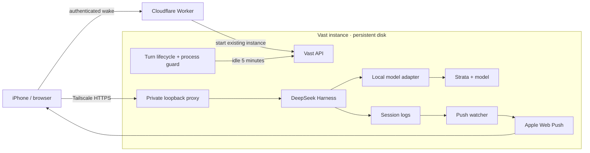

# StrataDashSeek

Run DeepSeek Harness, Strata and a local model together on one stoppable Vast.ai instance. Wake it from a free Cloudflare Worker, connect privately through Tailscale and receive iOS Web Push when work finishes.



The Worker hosts only the wake page and controller. Your projects, chat history and model requests do not pass through Cloudflare. The Vast token is held in Worker Secrets and in a root-only server file. Harness is bound to loopback and exposed only through Tailscale Serve, with its own browser authentication. No Funnel is enabled.

## Components

- `cloudflare/worker.mjs`: authenticated wake/status endpoints, signed Secure HttpOnly cookie, same-origin POST checks, optional private setup QR fragment. No KV, database or paid Worker services.
- `vast/supervisor.cjs`: parallel startup and restart of Harness, local model adapter, push service, watcher and idle guard. Harness/tools run as the unprivileged `harness` user.
- `vast/lifecycle.mjs`: tracks whole turns, including gaps between model calls and tool execution.
- `vast/idle-guard.py`: stops the existing instance after 300 idle seconds. Active turns, workspace processes, model activity, maintenance leases and stale lifecycle data prevent stopping.
- `mobile/`: iOS 16.4+ Home Screen PWA, one-time pairing and standard Service Worker push. Notifications contain only generic completion/error/attention text.

## Install on an existing Strata instance

Install Strata separately before using this package. `vast/start-strata.sh` serves Strata on `127.0.0.1:8080`, reusing the saved configuration on ordinary boots. Its provisioning fallback launches Qwen3.8 Flash Next IQ3_S, 128K, int8 KV, DFlash2 and CPU vision with 1536 MiB VRAM reserve. Model availability and installed Strata compatibility must be checked. The reference IQ3 weights need about 83.6 GB plus about 0.9 GB for vision; do not assume a disk can hold both complete IQ2 and IQ3 installations.

1. Copy this repository to `/data/harness/app`, then run `bash /data/harness/app/vast/install.sh` as root. The script verifies the official Node tarball checksum and pins Harness and Web Push versions.
2. Install Tailscale from its official Ubuntu repository. Start `tailscaled` with **both** `--state=/data/harness/root-secrets/tailscaled.state` and `--statedir=/data/harness/root-secrets/tailscale`, plus `--tun=userspace-networking --socket=/data/harness/tailscaled.sock`. Authenticate the server in your personal tailnet. Preserve its state and certificate directory across stops.
3. Copy `vast/config.example.json` to `/data/harness/config.json` and `vast/push-config.example.json` to `/data/harness/push-config.json`. Use the real Tailscale hostname and your Worker URL.
4. Copy `vast/provider.patch.example.yml` to `/data/harness/home/.dsh/profiles/web/cordis.patch.yml`. Create the parent directory if needed. The supervisor provides `STRATA_GATEWAY_KEY=local-strata`; this is a local adapter placeholder, not a Vast credential. The adapter binds only to loopback.
   Apply the HomeAI policy with `/data/harness/node/bin/node /data/harness/app/vast/prepare-homeai-profile.cjs` while Harness is stopped. It preserves the YAML expression tags and existing cloud entries, configures all four shipped agent presets, disables LLM titles and adds the whole-turn queue. The pinned runtime is Harness 0.2.2-rc.2 on Node 24.21.0. Do not copy Windows shell paths or the GameShift desktop application onto Linux.
5. Copy `vast/guard.example.json` to `/data/harness/root-secrets/guard.json`, enter the existing instance ID and leave `enabled:false` during validation. Put your scoped Vast token in `/data/harness/root-secrets/vast-api.key`. Keep the directory mode 0700 and files 0600, root-owned.
6. For a migration, copy the existing VAPID keys and subscription store to `/data/harness/secrets/`; otherwise the push service generates new keys. Make this directory 0700 and its files 0600, owned by `harness`. Never regenerate VAPID keys on every boot.
7. Preserve the existing `/root/onstart.sh` and append `nohup bash /data/harness/app/vast/start.sh > /data/harness/logs/supervisor.log 2>&1 < /dev/null &`. Start it once manually. The flock prevents duplicate supervisors. No package installs or model downloads run on normal boots.
8. Set up private HTTPS: `tailscale --socket=/data/harness/tailscaled.sock serve --bg http://127.0.0.1:3081`.
9. Run `python /data/harness/app/vast/admin.py paircode` using the virtual environment to obtain a private, single-use ten-minute code. Open `https://YOUR-HOST/phone/` from the iPhone with Tailscale enabled and enter the code. Add it to the Home Screen and enable notifications in the sidebar's bottom **More → Oznámení na iPhonu** menu. Browser authentication survives restarts for its cookie lifetime.
10. Verify a real task, push and a stop/start cycle, then set `enabled:true` in the root guard file. Do not leave an older controller with its own shorter idle timer active.

Supervisor paths are intentional and fixed to `/data/harness`; change them together if adapting the layout. Linux containers do not require systemd or a privileged TUN device.

## Deploy the wake Worker

Use current Node 24 and install the official `wrangler` CLI. Copy `cloudflare/wrangler.example.jsonc` to `cloudflare/wrangler.jsonc`; fill in the instance ID and private Harness URL. Register a workers.dev subdomain in your Cloudflare account if it has none. Authenticate Wrangler with Workers Scripts permissions and provide `CLOUDFLARE_ACCOUNT_ID` if account discovery is unavailable.

```sh
wrangler deploy --config cloudflare/wrangler.jsonc
wrangler secret put VAST_API_KEY --config cloudflare/wrangler.jsonc
wrangler secret put WAKE_ACCESS_KEY --config cloudflare/wrangler.jsonc
```

Use a scoped Vast key and at least 32 random bytes encoded as hex for `WAKE_ACCESS_KEY`. Keep both out of Git. The optional setup link is `https://YOUR-WORKER/#setup=YOUR_WAKE_KEY`; its fragment is cleared immediately and the key is exchanged in a same-origin POST. Treat any setup QR/link as a private credential. Normal use stores a signed 30-day cookie. Rotating `WAKE_ACCESS_KEY` invalidates existing wake cookies.

The page polls Vast only while visible; checking status never starts the GPU. Waking is idempotent for an already-started instance. After waking, the page probes the private server and opens it automatically. Tailscale must be connected.

## Automatic clients and monitoring

`desktop/open-harness.cjs` reads a private JSON configuration with `wakeUrl`, `wakeKeyFile`, `sshKeyFile`, `knownHostsFile` and `timeoutSeconds`. It wakes the fixed instance, waits for readiness and obtains the latest official native login URL over SSH. Keep this configuration and its keys outside the repository. The desktop wrapper should capture the returned URL and open it without logging it.

For an already authenticated Home Screen app, configure `wakeUrl` and `wakeKeyFile` in the private push configuration. The key file must be owned by `harness`, mode 0600. After explicit owner consent, the authenticated client receives this limited wake key and stores it locally. The Worker permits bearer requests only from the configured private Harness origin. It never gives the client the Vast API token. Optional `tailscaleAutoLoginUsers` in the private push configuration allows specified exact Tailscale login identities to obtain the normal native browser cookie automatically. The phone bootstrap invokes a same-origin POST when unauthenticated. Trust this identity header only behind private Tailscale Serve, which strips client-supplied identity headers; both bridge and push listener must remain loopback-only and Funnel disabled. Empty/missing allowlists, missing identities and different users fail closed. Pairing remains the fallback for other clients.

The Service Worker caches only the static phone shell, including its startup script. On opening or returning to the app, it checks readiness and can wake an offline server before loading Harness. API data, authenticated history and login URLs are never cached. Use a same-origin `/phone/` notification target so notification clicks enter this offline-capable shell. Validate an actual cold launch after updating the installed app; do not interrupt active jobs to test it.

**More → Monitor serveru** displays GPU, RAM, CPU, disk, Strata rates and recent request metrics. The root collector uses monotonic elapsed time to integrate sampled GPU watts into Wh. The UI also shows kWh (1000 Wh = 1 kWh), labels the measurement as a GPU-only estimate and displays its start time. It excludes CPU and whole-server consumption and resets when the collector restarts. It does not represent Vast rental charges. Reading metrics does not extend the idle lease.

For Windows history migrations, `vast/session-migration.py` maps path separators and case correctly and encodes the header in its own Zstd frame. Verify imported sessions with the native persistence reader, not just JSON decoding. A log containing event types unsupported by the target Harness must remain backed up and requires a compatible runtime/plugin; do not silently discard unknown events.

## Sleep rules and maintenance

HomeAI parity adds one root-turn FIFO across tool gaps, inherited ownership for explicitly requested children and a lazy full-stream gate for auxiliary LLM requests. One tool runs at a time, with at most one child and depth one. Normal generation uses medium reasoning (4096 budget) and a 32768 output ceiling. All presets use compaction headroom 12288, summary limit 8192, retained tail 8192 and one overflow recovery; summary generation explicitly uses reasoning off. Ordinary transient failures retry at most twice. Explicit payload-size HTTP 413 failures stop without unnecessary context recovery. This preserves the failure in history; it does not mask it as a successful response.

The adapter waits up to 180 seconds for the local model to finish loading, and cancellation while waiting prevents inference dispatch. Health checks and model catalog requests do not wake the instance. Queue ownership improves scheduling and cache continuity; it does not guarantee faster individual tasks or correct generated code. Hardware-specific worker/cache counts remain selected for the actual cloud CPU/GPU.

The idle timer is independent of browser connectivity. Closing Safari does not cancel an agent. An active turn or a long build keeps the instance awake; after work finishes the 300-second countdown starts. A pending approval/question inside an open turn may keep it awake until answered or cancelled. Persistent preview servers also count as workspace jobs: stop them when finished.

Unknown model status or a missing/stale plugin heartbeat holds the instance awake. This protects work but can cost money after a service fault; inspect `/data/harness/state/idle-status.json` and the service logs. It is not a guaranteed spending cap. A root-only `state/maintenance.json` with `{"until":UNIX_SECONDS}` temporarily holds sleep for maintenance. Do not use a browser poll as an always-on lease.

Stopping preserves the disk, not live processes or model cache. GPU availability on a stopped Vast rental is not reserved. A host failure, lease expiry or instance destruction can lose access to the disk; back up projects separately. This implementation never destroys or replaces the instance automatically.

## iOS and migration

Web Push works through Apple even when Safari is closed. Tailscale is still required to open the private Harness. The phone must keep the Home Screen app and notification permission. Provider acceptance is not proof of delivery: test on a locked phone.

Push subscriptions belong to a web origin. Copying keys keeps old installations deliverable, but changing from a PC hostname to a Vast hostname creates a new browser origin. Pair/add the new origin once. After confirming its notifications, retire the imported subscription using `retiredAt` in the private subscription store, retain a backup and restart the notifier when idle; publishing skips retired entries. Do not commit that store. Existing Windows session headers also require Linux cwd mapping and the official project-directory encoding; copying the old directory names unchanged is insufficient. The deployment keeps the original PC history as a rollback copy.

## Validation

```sh
node --test cloudflare/worker.test.mjs vast/lifecycle.test.mjs
node --test mobile/notifications.test.cjs
/data/harness/venv/bin/python vast/test-idle-guard.py
/data/harness/venv/bin/python /data/harness/app/vast/admin.py state
```

The tests cover authentication/CSRF, signed cookies, fixed instance selection, idempotent waking, concurrent turns, tool gaps, builds, unknown model state, stale heartbeats and maintenance. Live deployment measurements are recorded separately; unit tests alone do not establish iPhone delivery or cold-start speed.

## Cost model

The Worker should fit the Cloudflare Free request/CPU limits for personal use; no paid plan is selected. Vast compute is charged while running and disk storage continues while stopped. Add bandwidth, taxes and any provider pricing changes. Use your contract's current rates rather than treating this repository as a price guarantee.

Official references: [Harness source](https://github.com/deepseek-ai/deepseek-harness), [Workers limits](https://developers.cloudflare.com/workers/platform/limits/), [Tailscale Serve](https://tailscale.com/docs/features/tailscale-serve), [Vast instance FAQ](https://github.com/vast-ai/docs/blob/main/guides/reference/faq/instances.mdx).


## Recorded deployment

The latest `deployments/2026-11-14-budget-result.json` records the verified A4000/EPYC migration under a 2,000 CZK monthly target. At the recorded contract rates, 12 active hours/day plus 96 GB storage cost USD 47.36 per 30 days before transfers and tax. The old instance and disk were deleted after explicit approval and verification of the final encrypted local backup; their USD 10.24/month storage charge no longer continues. The model and HomeAI policy are unchanged. Automatic stop/wake, identity login and all 65 checks passed; one CSV comparison completed in 217 seconds versus the previous 334 seconds. These measurements are observations, not performance or availability guarantees.

`deployments/2026-11-14-homeai-iq3/` contains sanitized settings actually captured from the deployed stack, a checksum manifest and verification results. Take a new sanitized snapshot and push it before changing production configurations or versions. Private backups stay outside Git. Hardware search results are observations, not proof of inference speed; benchmark the same model and tasks before promoting another host.

Monitor telemetry normalizes CPU to the container quota and uses cgroup I/O counters rather than other tenants' host activity. It also exposes elapsed generation time, output budget and whole-turn queue ages. Energy remains an estimate for the GPU only, measured since the telemetry process started.

The dated benchmark in benchmarks/disposable-20261114 records three passing CSV runs (75–112 seconds, versus one 334-second reference), smaller tasks, the failed initial game and the bounded repair attempt. It is historical evidence with fixed deadlines, not an unattended installer. Its report includes all-in trial cost estimates and deletion confirmation. Offer RAM and instance-detail host RAM used different scales in this measurement; do not multiply the reported offer RAM by gpu_frac again. Validate the actual allocation.


