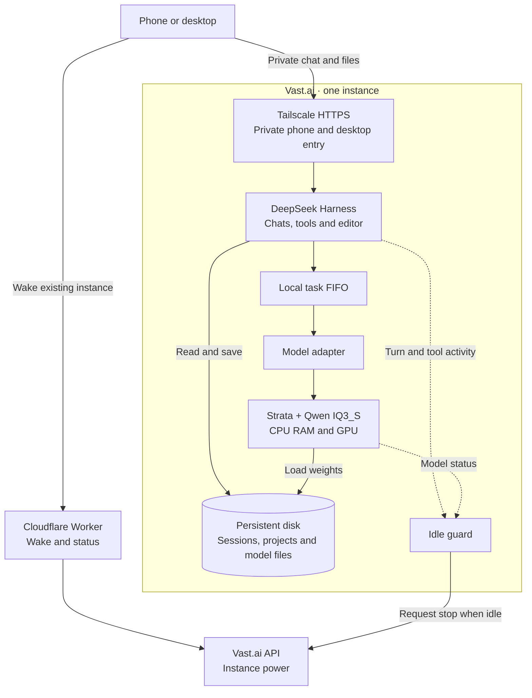
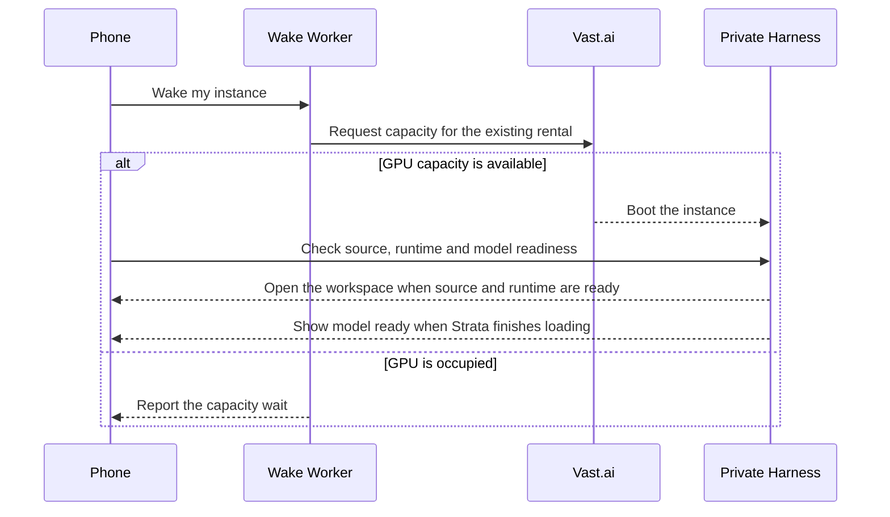

# StrataDashSeek

HomeAI runs DeepSeek Harness and a Strata-hosted Qwen model on one stoppable Vast.ai instance. Open the same private workspace from your phone or desktop to start a task, edit its files, run checks and preview the result. The instance disk holds your chats and projects between stops.

## Open HomeAI and run a task

1. Connect to Tailscale. Open the installed HomeAI app or your private wake link. On a new phone, [pair the device](docs/harness-operations.md#pair-a-phone) first.
2. Open a workspace and send a task. For example, ask for a temperature converter that displays 32 °F at 0 °C and 212 °F at 100 °C. To limit a run, expand **Task budget** before sending.
3. Open **Code – OSS** in the right sidebar to edit the current chat’s project. **Changes** shows saved changes as tools work. Use **Workspace files → Download** for a lasting copy of an output. A preview URL can expire while its source files remain on disk.
4. To return later, reopen the chat. For an archived chat, use **View options → Archived only → … → Archived files**. **More → Monitor serveru** shows the running server’s GPU, memory, disk and recent model requests.

## Architecture

The public Worker knows how to wake the configured instance. Once connected, the browser sends chat and file traffic directly to the private Harness over Tailscale. Code – OSS uses the current project in host mode. The optional [Apps and Docker worker](docs/applications.md) adds container builds and deployments for installations that enable it.

## What happens when you wake it?

- **While Qwen loads** the signed source and the running Harness must pass their own checks before the phone opens the workspace. Inference waits for the model. A fresh phone needs its first successful pairing before it can use the cached wake screen. [Readiness checks](docs/runtime-readiness.md)
- **During a task** the local FIFO admits one root task at a time and keeps its place across tool calls. Closing Safari does not cancel the task. The idle guard observes active turns, model activity, workspace processes and application work. [Scheduling](efficiency/README.md) · [Idle decision](vast/idle-guard.py)
- **After work finishes** the default idle timeout is **5 minutes** when automatic stop is enabled. Reading the monitor or leaving a chat open does not extend it. Apps has a separate 15-minute hold. A stale heartbeat or a failed sleep check can keep the instance running. [Idle and maintenance](docs/harness-operations.md#idle-and-maintenance)
- **After stop** the disk persists and GPU capacity is released. The wake link can request the original instance again. Another customer may be using that GPU, in which case opening the full workspace has to wait. Storage charges continue while the rental is stopped.

## Set up, operate or contribute

| I want to… | Start here |
| --- | --- |
| Install HomeAI on an existing Strata host | [Installation overview](docs/installation-overview.md) · [Installation commands](docs/harness-operations.md#install-the-harness) |
| Configure mobile access and the wake link | [Deploy the Worker](docs/harness-operations.md#deploy-the-wake-worker) · [Pair a phone](docs/harness-operations.md#pair-a-phone) |
| Use the sidebar, project tools or containers | [Workspace guide](docs/workspace-runtime.md) · [Embedded editor](workspace/codeoss-web/README.md) · [Applications](docs/applications.md) |
| Understand a budget, a stopped task or its files | [Task budgets and recovery](docs/harness-operations.md#task-budgets-and-recovery) · [Checkpoint recovery](docs/checkpoint-recovery.md) |
| Test a change and verify its deployment | [Local checks](docs/harness-operations.md#run-the-local-checks) · [Release CI](docs/release-ci.md) · [Signed startup](docs/startup-updates.md) |
| Estimate cost or compare a previous run | [Request budget](docs/request-budget.md) · [Recorded deployments](docs/harness-operations.md#recorded-deployments) |

To check what a particular server is running, compare `state.update.appliedCommit` in the owner Workbench API with the revision you expect, then inspect the readiness flags from `/phone/health`.
